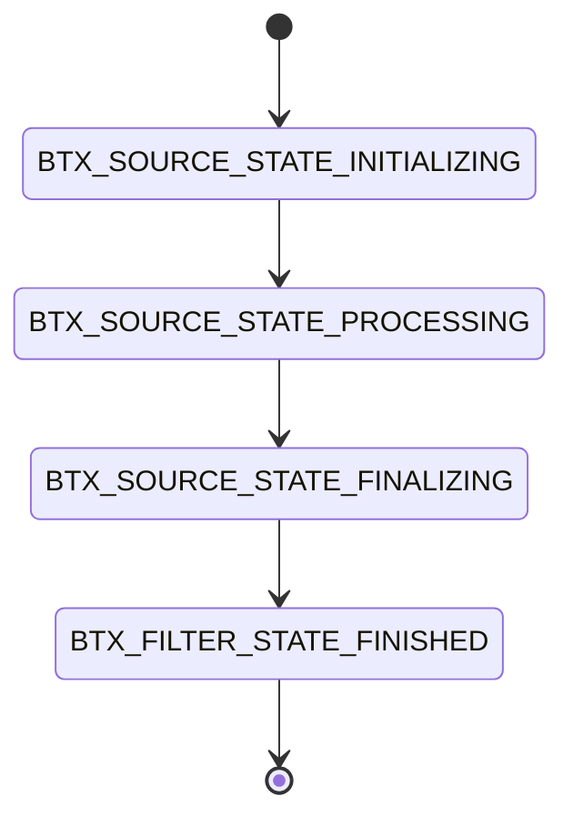
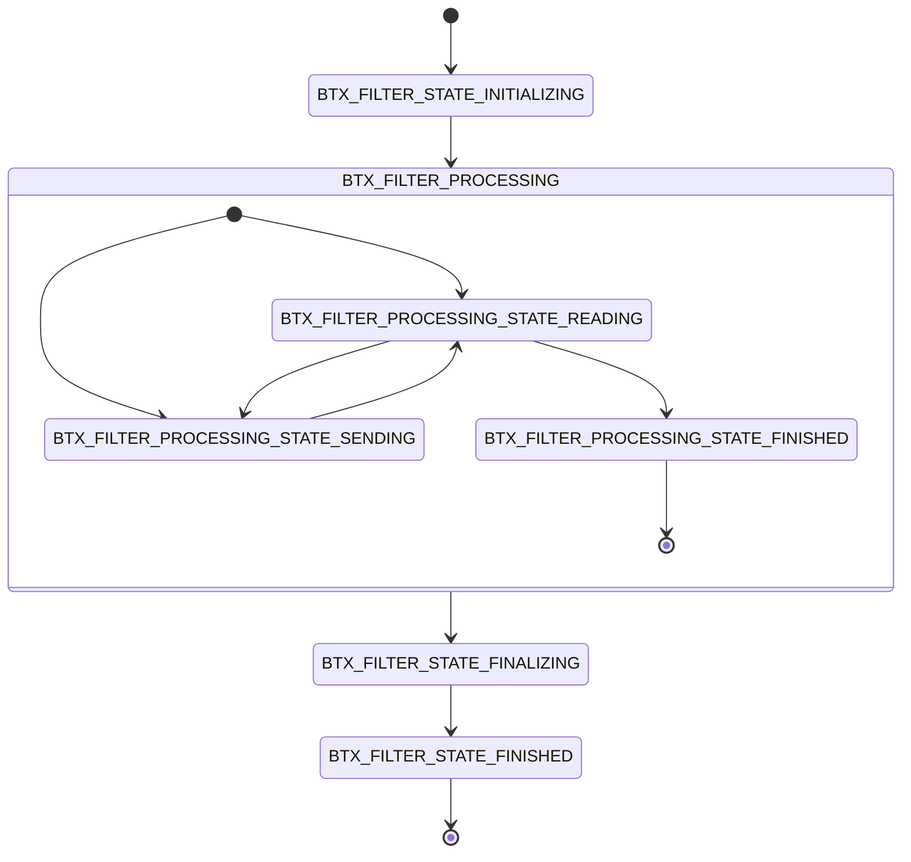

# What symbols to provide?

## Filter & Sink

Link with a object file who export the symbol `btx_register_usr_callbacks(void *)`.

The implementation of `btx_register_usr_callbacks` should conssist of calls to `btx_register_callbacks_#{stream_class_name}_#{event_class_name}(btx_handle, &callbacks)`.

## Source:

Link with a object file who export the symbol `btx_push_usr_messages(struct xprof_common_data *common_data)`.

# Function Provided

## Source & Filter
	
In the callbacks, and in the `btx_push_usr_messages`, you have access to `btx_push_message_{stream_class_name}_#{event_class_name}(struct xprof_common_data *common_data, ...)`.


## Routing messages

Two options decide what happens to messages, besides the event callbacks:

| option | component | modes |
|---|---|---|
| `--upstream-event-fallback MODE` | FILTER | `passthrough` (default), `drop`, `callback` |
| | SINK | `drop` (default), `callback` |
| `--downstream-message MODE` | SOURCE, FILTER | `push` (default), `callback` |

Any other combination is an error. With `callback`, the user registers a
`(void *btx_handle, void *usr_data, const bt_message *message)` callback; if none is registered,
the default mode applies.

- `--upstream-event-fallback`: the upstream events no callback is registered for (whether or not
  their class is in the upstream model). Messages that are not events are always forwarded by a
  filter and dropped by a sink. With `callback`, `btx_register_callbacks_upstream_event_fallback`:
  - FILTER: the callback owns the message. It sends it downstream with `btx_forward_message`
    (through the downstream message callback, if any), or puts its reference.
  - SINK: the message is borrowed; the sink puts its reference after the callback.
- `--downstream-message`: every message the component sends downstream (its own events, its stream
  messages, and what a filter forwards). With `callback`, `btx_register_callbacks_downstream_message`:
  the callback owns the message, and puts it in the output queue with `btx_push_message`, or puts
  its reference. What it sends with `btx_push_message_<name>` comes back to it.

With `callback` for either option, the upstream model is optional (the callbacks see every event).

How a filter routes an upstream message:

```
upstream message
├─ not an event (stream/packet beginning/end, ...) → forwarded
└─ event: is a callback registered for its class?
   ├─ yes → the callbacks run with the decoded fields, then the message is put
   │        (to send something downstream, they create events with btx_push_message_<name> → forwarded)
   └─ no  → --upstream-event-fallback
            ├─ passthrough → forwarded
            ├─ drop        → put
            └─ callback    → the callback owns it: btx_forward_message → forwarded, or put

the filter's own stream beginning/end messages → forwarded

forwarded → --downstream-message
            ├─ push     → output queue
            └─ callback → the callback owns it: btx_push_message → output queue, or put
```

# Source Description

## State Machine



# Filter Description

## State Machine



# Sink Description

At finalization we will call the `btx_user_finalization(struct xprof_common_data *common_data)`

# Callbacks Registration and Calling order
 
```
0 register_callback
1 call_initialize_component # Cannot Push
2 call_read_params
3   stream_begin
4       call_initialize_processing # Can Push
5           call_callbacks
5       call_finalize_processing # Can Push
6   stream_end
7 call_finalize_component # Cannot push
```
