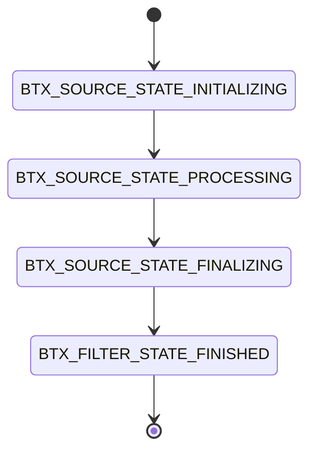
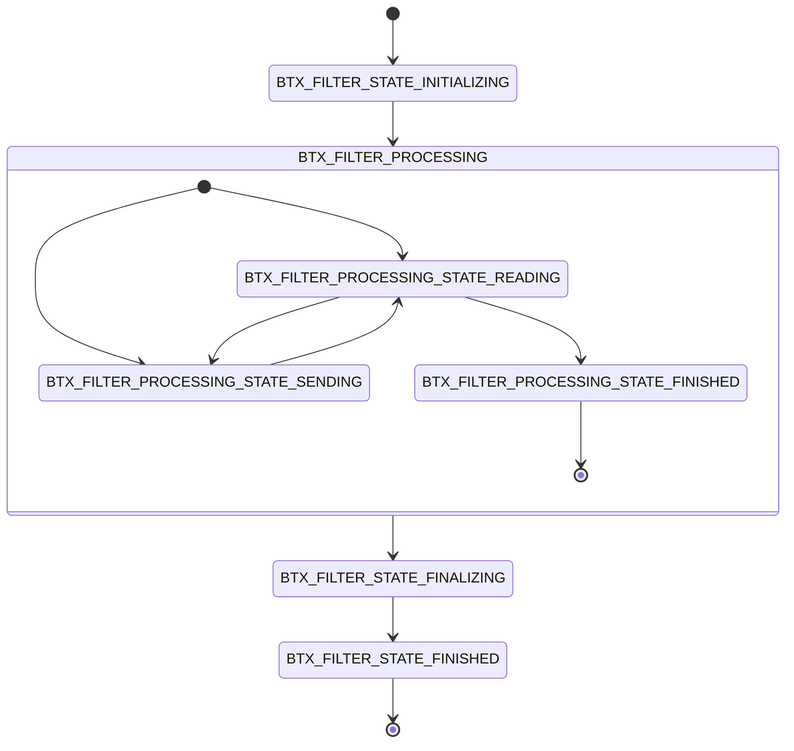

# What symbols to provide?

## Filter & Sink

Link with a object file who export the symbol `btx_register_usr_callbacks(void *)`.

The implementation of `btx_register_usr_callbacks` should conssist of calls to `btx_register_callbacks_#{stream_class_name}_#{event_class_name}(btx_handle, &callbacks)`.

## Source:

Link with a object file who export the symbol `btx_push_usr_messages(struct xprof_common_data *common_data)`.

# Function Provided

## Source & Filter
	
In the callbacks, and in the `btx_push_usr_messages`, you have access to `btx_push_message_{stream_class_name}_#{event_class_name}(struct xprof_common_data *common_data, ...)`.


## Routing messages

Besides the event callbacks, which get the decoded fields of the events of their class, two
*additional callbacks* get the `bt_message` itself. They are enabled at generation time:

| `--enable-additional-callbacks NAMES` | component | callback |
|---|---|---|
| `upstream_event_fallback` | FILTER, SINK | an upstream event no callback is registered for |
| `downstream_message` | SOURCE, FILTER | every message the component sends downstream |

Both are `(void *btx_handle, void *usr_data, const bt_message *message)`, registered with
`btx_register_callback_<name>`. There is one callback per name (hence `callback`, singular,
unlike the `btx_register_callbacks_` of the events): registering another one replaces it.
A registered additional callback always runs; without one, the default applies:

- Upstream event fallback: the upstream events no callback is registered for (whether or not their
  class is in the upstream model). Messages that are not events are always forwarded by a filter and
  dropped by a sink.
  - FILTER: the callback owns the message. It sends it downstream with `btx_push_message`, or puts
    its reference. Without a callback, `--upstream-event-fallback MODE` applies: `passthrough`
    (default) forwards the event, `drop` puts it.
  - SINK: the message is borrowed; the sink puts its reference after the callback. Without a
    callback, the event is dropped.
- Downstream message: every message the component sends downstream (its own events, its stream
  messages, and what a filter forwards). The callback owns the message, and puts it in the output
  queue with `btx_direct_push_message`, or puts its reference. Without a callback, the message goes
  to the output queue.

`--upstream-event-fallback` applies to a FILTER only. With an additional callback enabled, the upstream
model is optional (the callbacks see every event).

### Sending messages downstream

`btx_handle` is the one every callback receives (the component).

| function | sends | through the downstream message callback | exists with |
|---|---|---|---|
| `btx_push_message_<name>(btx_handle, ...)` | a new event of the downstream model | yes | always |
| `btx_push_message(btx_handle, message)` | the message the fallback callback owns | yes | `--enable-additional-callbacks upstream_event_fallback` (FILTER) |
| `btx_direct_push_message(btx_handle, message)` | the message the downstream callback owns, to the output queue | no | `--enable-additional-callbacks downstream_message` |

In the downstream message callback, use `btx_direct_push_message` to let a message through:
`btx_push_message` would give it back to the same callback, forever. What the callback creates with
`btx_push_message_<name>` comes back to it, like any message sent downstream.

How a filter routes an upstream message:

```
upstream message
├─ not an event (stream/packet beginning/end, ...) → forwarded
└─ event: is a callback registered for its class?
   ├─ yes → the callbacks run with the decoded fields, then the message is put
   │        (to send something downstream, they create events with btx_push_message_<name> → forwarded)
   └─ no  → is an upstream event fallback callback registered?
            ├─ yes → the callback owns it: btx_push_message → forwarded, or put
            └─ no  → --upstream-event-fallback
                     ├─ passthrough → forwarded
                     └─ drop        → put

the filter's own stream beginning/end messages → forwarded

forwarded → is a downstream message callback registered?
            ├─ yes → the callback owns it: btx_direct_push_message → output queue, or put
            └─ no  → output queue
```

# Source Description

## State Machine



# Filter Description

## State Machine



# Sink Description

At finalization we will call the `btx_user_finalization(struct xprof_common_data *common_data)`

# Callbacks Registration and Calling order
 
```
0 register_callback
1 call_initialize_component # Cannot Push
2 call_read_params
3   stream_begin
4       call_initialize_processing # Can Push
5           call_callbacks
5       call_finalize_processing # Can Push
6   stream_end
7 call_finalize_component # Cannot push
```
